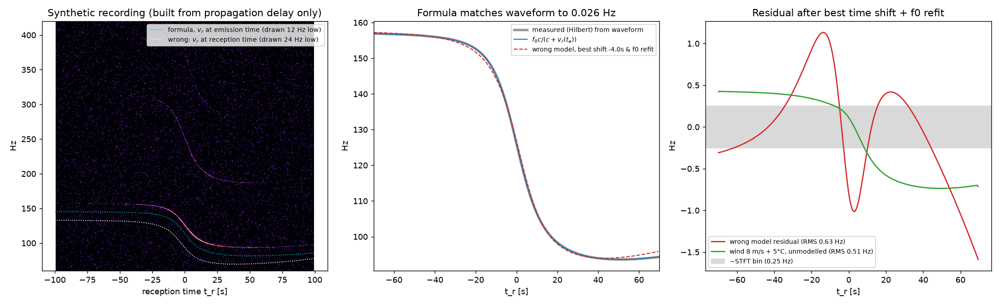
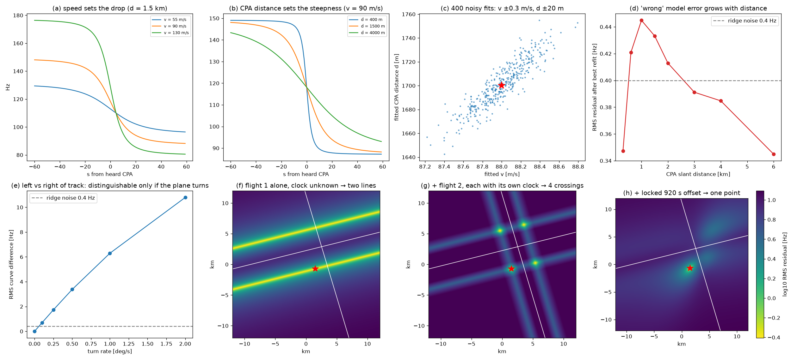
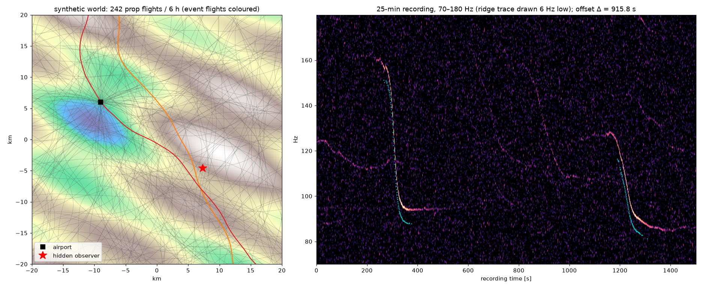
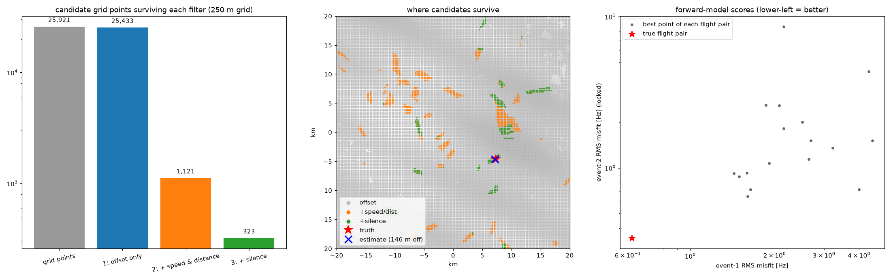
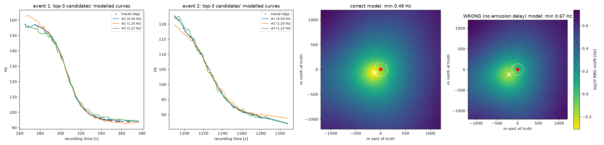
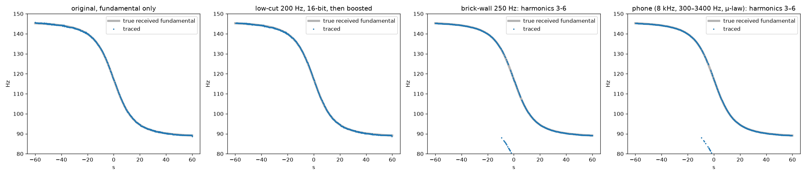

# Can an aircraft Doppler curve geolocate an audio recording? Checking the claim with a coding agent.

**Subject:** colsto, *"I discovered a sound that leaks your exact location (and it's everywhere)"*, YouTube, 29 min ([video](https://www.youtube.com/watch?v=UytYrhYLOKI))

**TLDR**: The method is plausible, and Claude was able to validate it and create a detailed report in ~30m wall clock time and an API cost of ~10USD.

The rest of this report is AI-generated, but here's my take: Systems described at the level of detail common in YouTube video or conference talks can be rather easily reproduced by modern coding agents. The method being math-heavy is probably a benefit due to easy verifiability.


## Why this report exists

**What prompted it.** I came across the video above. Its author takes a security-camera recording with no visual clues and geolocates it from the faint Doppler "whoosh" of passing propeller aircraft. The Doppler curves are matched against public ADS-B flight-tracking data for the whole contiguous US. The claimed result is a fix within "a couple hundred feet".

**Initial research question.** Is this a hoax video, or does it actually work? Is the physics right, are the on-screen numbers consistent, and would the described pipeline really single out one location?

**Side question.** The video description ends with:

> "No code or tools are being released."

The question: what does withholding code and technical details protect against, now that anyone can buy access to strong models and coding agents? How much of the method can a commercially available model reconstruct and check from the public narration alone, and how fast? The model used here, Claude Opus 5.5, is not Anthropic's most capable model. It is the affordable middle-to-upper tier that most people would actually use. So this is a test of what is *easily* reproducible today, not a best case. The video is a nice example because it was published the day the Claude session was run, so the session had to start from the video itself. Answered in [§6](#6-the-side-question-what-does-not-releasing-code-protect).

## Verdict

**Not a hoax.** The physics is correct, and every number we could check from the video is consistent. The method works end to end on synthetic data.

* With **two flyovers and an unknown time of day**, the correct flight pair ranked first in 6 of 6 random synthetic worlds.
* The hidden observer was found to within **85–465 m** in 5 of those worlds, and to 830 m in the sixth. That is with unmodelled wind, cold air, a barometric altitude bias and noisy ADS-B.
* With no model errors the observer was found to **4 m**.
* The core idea, estimating aircraft speed and range from propeller Doppler, has been published acoustics since the early 1990s (Ferguson, JASA 1992).
* The data the method needs is free or cheap, and the compute is modest.

**What the video overstates or glosses over:**

* **The single-flight example is the weakest claim.** With the clock known to ±1 min it worked in 4/6 of our worlds. With the **1-hour window shown on the video's own slide it failed in 6/6**: the true flight ranked 2nd or worse, a near-tie with other flights' segments. Without strong manoeuvres there is an along-track and left/right ambiguity.
* **The "wrong model" warning is overstated.** Skipping the emission delay worsens the fit but doesn't make the search "fail entirely".
* **The method needs the aircraft to be in ADS-B.** Low-level GA is not required to broadcast.
* **The silence filter can wrongly exclude the true point.** Aircraft that aren't in the data, and refraction shadow zones, both cause this.

## 1. How the method works

1. **Find the curve.** A propeller aircraft emits a tone at its blade-passage frequency (about 50–150 Hz). A fixed microphone hears it Doppler-shifted. The spectrogram shows a falling S-curve, even when you can't hear it.
2. **Read the curve.** The frequency drop gives the aircraft's **speed**. The steepness of the drop gives its **closest-approach slant distance**. The midpoint gives the **heard closest-approach time** on the recording's own clock.
3. **Match against ADS-B.** Historical ADS-B gives the position, altitude and time of almost every aircraft. For each candidate ground point and flight, predict when it would have been heard and at what distance and speed. Keep points where *two* flights match with the recording's offset (920 s), and where nothing else would have been heard in between.
4. **Confirm with the exact curve.** For the survivors, compute the exact Doppler curve each candidate point would have heard from the real, turning flight path. Lock the second event's timing to the first. Pick the best match.

## 2. Claim-by-claim

| # | claim in the video | our check | verdict | details |
|---|---|---|---|---|
| 1 | t_r = t_e + r(t_e)/c; f = f₀·c/(c+v_r) | Derived from wavefront propagation. A waveform synthesised **only** from propagation delay matches the formula to **0.026 Hz** | ✔ correct | [DD1](docs/01-doppler-physics.md) |
| 2 | On-screen numbers (25.00 s, 16.910 s, 96.07 Hz, 109.9 Hz, 141 m, "moon and back ~200×") | All recomputed and consistent; the football-field claim works out to 194 trips | ✔ | [DD1 §5](docs/01-doppler-physics.md#5-numbers-on-screen) |
| 3 | Speed sets the drop, CPA distance sets the steepness | Closed form for a straight pass. A 2-min trace with 0.4 Hz noise gives v ±0.3 m/s and d ±20 m. Matches published acoustic work | ✔ | [DD2](docs/02-information-in-a-curve.md) |
| 4 | Using reception-time velocity "makes an entirely wrong curve" | The shape really differs (up to 1.6 Hz), but after a time shift the error is about the noise level. In the locked two-event search it costs score margin and accuracy, not the answer | ◐ overstated | [DD1 §3](docs/01-doppler-physics.md#3-the-wrong-model-the-video-warns-about), [DD3](docs/03-end-to-end-simulation.md) |
| 5 | Turns, speed and altitude changes are encoded in the curve and break ambiguities | Mirror observers differ by 0.7 Hz at a 0.1°/s turn and 6.3 Hz at 1°/s; a perfectly straight pass is ambiguous | ✔ | [DD2 §4](docs/02-information-in-a-curve.md) |
| 6 | Offset filter alone barely narrows things; speed, distance and silence filters shrink the set; the forward model picks one pair | Reproduced: offset only keeps 98 % of points, + speed/distance 4 %, + silence 1.2 %; true pair wins in 6/6 worlds | ✔ | [DD3](docs/03-end-to-end-simulation.md) |
| 7 | A 200 m grid is too coarse; 141 m off scores badly | At 141 m the misfit is 1.7–2.2× the best | ✔ | [DD3](docs/03-end-to-end-simulation.md) |
| 8 | Video counts 35k → 73k → 15k nationwide | A random-traffic model with airport clustering reproduces them (~74k, ~20 % silence survival) | ✔ plausible | [DD5 §6](docs/05-algorithms-and-compute.md) |
| 9 | Located "within a couple hundred feet" | Synthetic, two events: 4 m ideal, 85–830 m with realistic errors | ◐ plausible with dense ADS-B and little weather error | [DD3](docs/03-end-to-end-simulation.md) |
| 10 | One faint 60 s flyover + a known time is enough (slide: "1 hour") | Clock ±1 min: right flight in 5/6 worlds, good location in 4/6. 1-hour window: true flight #1 in **0/6**, near ties with other flights | ✘ not reproduced as stated; ◐ fragile even with a ±1 min clock | [DD3](docs/03-end-to-end-simulation.md#robustness-7-random-worlds-realistic-mismatches-on) |
| 11 | High-pass doesn't help; boosting restores it | A linear filter preserves narrow-band SNR, so an editor low-cut has no effect after per-bin normalisation | ✔ | [DD4 §4](docs/04-real-world-limits.md) |
| 12 | Survives phone compression | The fundamental is removed by the 300–3400 Hz band, but harmonics carry the same curve: 96 % of frames recovered with strong harmonics, 51 % with weak | ✔ conditional | [DD4 §4](docs/04-real-world-limits.md) |
| 13 | "Took months, 5000 lines, 50 GB parquet, super computationally expensive" | Data is about 0.3–3 GB of non-jet tracks per day. The naive per-flight grid is about 60 GB. A smart build runs in minutes on a laptop | ✔ consistent, but avoidable | [DD5](docs/05-algorithms-and-compute.md) |

## 3. Key evidence

### The physics is exact
The Doppler formula reproduces a waveform built only from "sound emitted at t_e arrives at t_e + r/c". The video's "wrong" model and unmodelled wind each leave residuals of only about 0.5 Hz.



### Why two curves pin a point
One curve with an unknown clock limits the observer to **two lines** parallel to the track. Two curves, each with its own clock, give **four crossings**. Locking the two clocks together through the measured offset leaves **one point**. The system is over-determined, so a wrong flight pair has to match by coincidence.



### The full pipeline finds the hidden observer
The synthetic test has 242 propeller flights in 6 hours over a 40×40 km region with an airport. The recording is 25 minutes long, contains two faint flyovers, and has no clock and no location.





### Countermeasures


## 4. Is it practical?

* **Data.** One day of CONUS non-jet ADS-B is about 10⁷–10⁸ points (0.3–3 GB). It's freely available from adsb.lol or OpenSky (research), and paid from ADS-B Exchange. A DEM resampled to 100 m is 1.5 GB.
* **Compute.** The two-event search over CONUS for one day takes about 5–10 min on a laptop, mostly reading the input. The forward model costs about 70 s on a laptop or about 2 s on a GPU. A week of data is about 7× more. A city-sized area is trivial even over long time windows. See [DD5](docs/05-algorithms-and-compute.md).
* **Biggest real-world risks are missing data, not compute:**
  * the aircraft may not be in ADS-B at all;
  * sparse traces during turns;
  * barometric altitude error;
  * weather refraction affecting the silence filter.

## 5. Limits of this check

* We **could not reproduce the video's actual result.** We don't have its audio file or its ADS-B extract. All end-to-end evidence is synthetic, with ground truth we control.
* The synthetic noise is white. Real recordings have wind, traffic and hum, plus ground-reflection notches. Event detection here is automatic, and in 1 of 7 worlds it failed because it found an extra distant flight. A human analyst would handle that, but it shows fragility.
* Our "realistic" errors cover wind, temperature, baro bias, ADS-B noise and 2 s sampling. They don't cover missing aircraft, multi-second trace gaps, or wind-shear refraction.

## 6. The side question: what does not releasing code protect?

**What was reconstructed from the narration alone.** In about 27 minutes of wall time, with about 200 words of human steering and an API-price equivalent of about $10 ([time and cost](#time-and-cost)), a mid-tier commercial model produced:

* **the full method**: emission-time Doppler physics, the CPA tables, the offset, speed, distance and silence filters, locked two-event scoring, the grid-resolution argument, and the countermeasure analysis;
* **checks** of every on-screen number, plus a first-principles test of the physics;
* **a working end-to-end simulation** that recovers a hidden observer from audio plus flight tracks;
* **a data and compute plan** at CONUS scale, which concludes it runs in minutes on a laptop;
* **a literature trail** showing the core technique has been published since 1992.

**What was not reconstructed:**

* running it on real ADS-B, DEM and audio, which means data access, cleaning, and messy event detection;
* the author's actual result.

[Deep dive 5](docs/05-algorithms-and-compute.md) argues that this remainder is engineering, not research. The data is public, a day of US propeller traffic is a few gigabytes, and the compute is small.

**Assessment.**

* **The narration *is* the specification.** A careful step-by-step explanation of a method, as this video gives, transfers almost all of the know-how that matters. Withholding the code removes perhaps the last 10–20 % of effort and the polish, not the capability. At these speeds that is a matter of days of engineering, not months of research.
* **Withholding code is now mostly a speed bump.** It slows down casual misuse and keeps a turnkey tool out of circulation, which has some value. It does not keep the method from anyone who can describe the video to a coding agent.
* **The real protective factors are elsewhere:**
  * access to historical flight data;
  * the method's real-world fragility, especially the single-flight case;
  * whether this particular combination of recording and location is worth anyone's effort.
* **Caveat.** Our end-to-end evidence is synthetic. "Easily reproduced" here means *understood, re-derived and simulated*, not *run successfully on real data*.

## Deep dives

1. [The Doppler model, from first principles](docs/01-doppler-physics.md): derivation, emission time, the wrong model, wind and temperature, on-screen numbers.
2. [What one curve tells you, and why two can fix a location](docs/02-information-in-a-curve.md): closed form, fit precision, mirror ambiguity, locus geometry, prior literature.
3. [End-to-end synthetic test](docs/03-end-to-end-simulation.md): world, funnel, scoring, wrong-model control, 7-seed robustness, single-flight case.
4. [Real-world data, error sources and countermeasures](docs/04-real-world-limits.md): ADS-B coverage and quality, DEM, propagation, high-pass and phone tests, ENF precedent.
5. [Algorithms, data structures and compute budget](docs/05-algorithms-and-compute.md): data volumes, per-stage algorithms, budgets, false-match model. Written by a separate analysis agent.

## Methodology

### Inputs (all public)
1. **The video's transcript.** The full 29-minute narration, timestamped. It is not redistributed here; the docs cite timestamps.
2. **Three screenshots from the video,** also not redistributed:
   * **The author's interactive tool, "Building the Doppler Curve, Step by Step".**
     * A top-down map shows an observer, a coloured aircraft track, and the velocity vector with its radial component.
     * A middle panel works one example through, step by step: reception time t_r = 25.00 s, then the equation t_r = t_e + r(t_e)/c, which gives emission time t_e = 16.910 s.
     * At t_e it shows position (2367, 1264, 1020) m, velocity (140, 16.8, 0) m/s, slant range r = 2775 m and radial speed v_r = 121.16 m/s.
     * The panel ends with the Doppler result, f = 130·343/(343+121.16) = 96.07 Hz.
     * The right panel plots "Position" against "Delayed" frequency curves over time.
   * **A slide, "1st example: 2 flights, unknown time of day, unknown location".** A triangle trades off three things: a temporal constraint (when it was filmed), a spatial constraint (where), and the number of flights in the recording.
   * **A comparison table.**

     | | Example 1 | Example 2 |
     |---|---|---|
     | Spatial | Full US | Full US |
     | Temporal | 1 day | 1 hour |
     | # of flights | 2 (~30 min) | 1 (~60 s) |
3. **The video description,** for the quote above and its summary of the pipeline.

Nothing else from the author was used: no audio, no ADS-B extract, no code. All other facts come from the public literature, which the subagent and each deep dive cite.

### Process
* **Tooling.**
  * Claude Code (desktop app) running **Claude Opus 5.5**, plus two subagents, also Opus 5.5: one to collect and verify sources, and one at high effort for [algorithms and compute](docs/05-algorithms-and-compute.md).
  * Every computation is a self-contained [uv inline-dependency script](https://docs.astral.sh/uv/guides/scripts/) using numpy, scipy and matplotlib.
* **Human input.** One initial prompt (about 70 words plus the screenshots), then about six short steering messages: output format, deep dives, the subagent, versioning, cost, and this restructuring. That is roughly 200 words before this final edit. No code or analysis was written by hand.
* **Steps.**
  1. Re-derive and check the on-screen numbers.
  2. Derive the Doppler and emission-time model from wave propagation, and check it against a synthesised waveform.
  3. Characterise what one curve, and then two, can constrain.
  4. Build the full pipeline on a synthetic world with a hidden answer, under realistic model errors, across several random worlds.
  5. Test the countermeasures.
  6. Collect sources.
  7. Estimate the real-world data volume and compute.
* **What this repo does not contain:** any real flight data, any real recordings, or a pipeline that ingests real ADS-B. All end-to-end evidence is synthetic.

### Time and cost
The wall time below runs from the first to the last model response in each phase. The cost is token usage priced at Anthropic API list prices for Opus 5.5:

* $4 per million input tokens
* $20 per million output tokens
* $0.20 per million tokens read from cache
* $5 or $8 per million tokens written to cache (5-minute or 1-hour lifetime)

The work actually ran on a Claude **subscription**, so no API charges were incurred. The dollar figures only show what the same work would cost on the API. Computed with [`scripts/07_token_usage.py`](scripts/07_token_usage.py) from the session transcripts.

| phase | what | wall time | API calls | output tokens | API-price equivalent |
|---|---|---|---|---|---|
| 1 · first run | prompt → verified report, five deep dives, plots, sources, compute budget (incl. both subagents) | **27 min** | 105 | 185 k | **≈ $9.50** |
| 2 · finalisation | restructure for publication, re-test example 2 against the slide's 1-hour window, fix an alignment bug, 12 extra robustness runs, this section | **26 min**, of which about 12 min waiting on the parallel simulation runs | 34 | 29 k | **≈ $3.14** |

**Total: about 53 min wall time, ≈ $12.64 API-equivalent, 25.5 M tokens processed.** Over 95 % of those tokens were the conversation re-read from the prompt cache; without caching the same work would cost about $105. The final commit and closing message, a few more calls, are not in these figures. Raw output: [`plots/07_output.txt`](plots/07_output.txt). **Not counted:**
* the side requests Claude Code makes for web search and fetch (the sources agent made 83 tool calls, mostly web lookups);
* local CPU time for the simulations (minutes on a laptop).

## Reproduce

All scripts are self-contained [uv inline-dependency scripts](https://docs.astral.sh/uv/guides/scripts/):

```bash
uv run scripts/01_check_onscreen_numbers.py
```

```bash
uv run scripts/02_doppler_first_principles.py
```

```bash
uv run scripts/03_curve_information.py
```

```bash
uv run scripts/04_geolocate_sim.py --ex2-window 60 && uv run scripts/04_geolocate_sim.py --ideal --ex2-window 60
```

```bash
uv run scripts/05_compute_budget.py
```

```bash
uv run scripts/06_phone_and_highpass.py --harmonics strong
```

## Sources

Full per-topic lists are in each deep dive. The principal sources, grouped:

**The video**
- colsto, "I discovered a sound that leaks your exact location (and it's everywhere)", YouTube, 2026. https://www.youtube.com/watch?v=UytYrhYLOKI. We worked from its transcript, three screenshots and the video description. None of them are redistributed here.

**Prior acoustic flight-parameter estimation**
- B. G. Ferguson, JASA 92(3):1403–1407 (1992). https://doi.org/10.1121/1.403934
- B. G. Ferguson & B. G. Quinn, JASA 96(2):821–827 (1994). https://doi.org/10.1121/1.410320
- B. G. Ferguson & K. W. Lo, JASA 108(4):1763–1771 (2000). https://doi.org/10.1121/1.1286150

**Doppler, sound speed, propagation**
- Wikipedia, "Doppler effect". https://en.wikipedia.org/wiki/Doppler_effect · HyperPhysics. https://hyperphysics.gsu.edu/hbase/Sound/dopp.html
- Wikipedia, "Speed of sound". https://en.wikipedia.org/wiki/Speed_of_sound
- T. F. W. Embleton, "Tutorial on sound propagation outdoors", JASA 100:31–48 (1996). https://doi.org/10.1121/1.415879
- ISO 9613-1:1993, atmospheric absorption. https://www.iso.org/standard/17426.html · Bass et al., JASA 97:680 (1995). https://doi.org/10.1121/1.412989

**Propeller noise**
- NASA TP-2356 (McCurdy & Powell, 1984). https://ntrs.nasa.gov/citations/19840024054
- NASA RP-1258, *Aeroacoustics of Flight Vehicles* (1991). https://ntrs.nasa.gov/citations/19920001380

**ADS-B: regulation, format, data**
- 14 CFR 91.225 / 91.227. https://www.law.cornell.edu/cfr/text/14/91.225 · https://www.law.cornell.edu/cfr/text/14/91.227
- J. Sun, *The 1090 Megahertz Riddle*. https://mode-s.org/1090mhz/content/ads-b/1-basics.html
- OpenSky Trino docs. https://openskynetwork.github.io/opensky-api/trino.html · adsb.lol globe_history. https://github.com/adsblol/globe_history · ADS-B Exchange. https://www.adsbexchange.com/data-products/
- ICAO Doc 8643. https://www.icao.int/publications/doc-8643-aircraft-type-designators
- FAA Air Traffic by the Numbers. https://www.faa.gov/air_traffic/by_the_numbers. Retrieved via search index; the site blocks automated fetching.

**Elevation**
- USGS 3DEP accuracy FAQ. https://www.usgs.gov/faqs/what-vertical-accuracy-3d-elevation-program-3dep-dems · Copernicus DEM on AWS. https://registry.opendata.aws/copernicus-dem/

**Telephony**
- ITU-T P.310 (300–3400 Hz). https://www.itu.int/dms_pubrec/itu-t/rec/p/T-REC-P.310-200005-S%21%21SUM-HTM-E.htm · ITU-T G.722 (50–7000 Hz). https://www.itu.int/dms_pubrec/itu-t/rec/g/T-REC-G.722-201209-I!!SUM-HTM-E.htm

**Analogous forensic technique (ENF)**
- C. Grigoras, Forensic Sci. Int. 167:136–145 (2007). https://doi.org/10.1016/j.forsciint.2006.06.033
