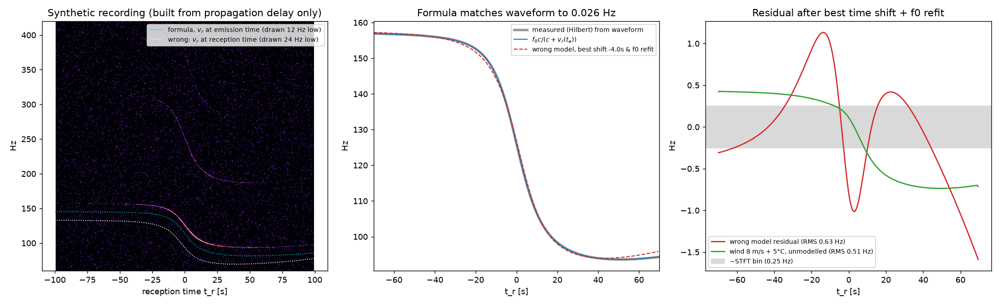

# Deep dive 1: The Doppler model, from first principles

[← back to report](../README.md) · script: [`scripts/02_doppler_first_principles.py`](../scripts/02_doppler_first_principles.py), [`scripts/01_check_onscreen_numbers.py`](../scripts/01_check_onscreen_numbers.py)

## 1. Derivation

Take a stationary observer at **o** and a sound source on a path **x**(t). Assume still air with sound speed *c*.

A wavefront leaves the source at **emission time** *t_e*. It reaches the observer at **reception time**

$$t_r = t_e + \frac{r(t_e)}{c}, \qquad r(t_e) = \lVert \mathbf{x}(t_e) - \mathbf{o} \rVert .$$

This is the first equation in the video's screenshot.

The source emits a tone *f₀*, so its phase is φ = 2π f₀ t_e. The observer hears that same phase at *t_r*. The received frequency is therefore

$$f = \frac{1}{2\pi}\frac{d\varphi}{dt_r} = f_0 \frac{dt_e}{dt_r} = \frac{f_0}{1 + \dot r(t_e)/c} = f_0\,\frac{c}{c + v_r(t_e)} .$$

Here $v_r = \dot r = \mathbf{v}\cdot(\mathbf{x}-\mathbf{o})/r$ is the radial velocity, positive when the source moves away. This is the second equation in the screenshot. The only physical input is that sound travels at *c* relative to the air. This is the standard moving-source Doppler formula [Wikipedia: Doppler effect; HyperPhysics]. For an oblique path it uses the radial component of the velocity.

The derivation also says *when* each velocity applies: the one at **t_e**, not t_r. The video makes the same point at 16:30–17:30.

**Wind.** Let uniform wind **w** carry the wavefront. Reception then happens when ‖**o** − **x**(t_e) − **w**(t_r − t_e)‖ = c (t_r − t_e). Received frequency is still f₀·dt_e/dt_r. The script solves both cases by fixed-point iteration on the delay. The iteration converges because |v|/c < 1 for a subsonic source. Six to twelve iterations reach sub-millisecond accuracy.

## 2. Check: build a waveform, measure it, and compare with the formula

The script synthesises audio **only** from "phase emitted at t_e arrives at t_e + r/c". The aircraft flies at 90 m/s and 1000 m AGL. It passes 800 m to the side, starts a 1.2°/s turn, climbs slowly, and plays a 118 Hz tone with 2 harmonics. The script then measures instantaneous frequency with a Hilbert transform and compares it with $f_0 c/(c+v_r(t_e))$.

| quantity | result |
|---|---|
| max \|measured − formula\| | **0.026 Hz** (median 0.0003 Hz) |
| CPA slant distance | 1280 m (r/c = 3.7 s) |

*Left:* spectrogram of the synthetic recording. The fundamental and 2nd/3rd harmonics are visible. The overlays are drawn offset so they don't hide the ridge. *Middle:* the formula (blue) lies on the waveform measurement (grey). *Right:* residuals of the alternative models described below.

## 3. The "wrong model" the video warns about

The video says that plotting f₀·c/(c+v_r(**t**)) at time t, i.e. using radial velocity at reception time, gives "an entirely wrong curve", not just a delayed one. The script tests this. It gives the wrong model every advantage: a free time shift and a free f₀ rescale.

| | result |
|---|---|
| best shift | −3.98 s (≈ r/c, as expected) |
| residual after best shift + f₀ refit | **RMS 0.63 Hz, max 1.59 Hz** |

**Verdict: true, but the effect is small.** The two curves differ in *shape*, not only in time. The approach is compressed and the recession stretched, because the emission-to-reception delay changes along the pass. But the difference is under 2 Hz, about the noise of a traced ridge. In [deep dive 2](02-information-in-a-curve.md) the single-curve difference stays at 0.35–0.45 Hz RMS for CPA distances from 0.3 to 6 km.

The error matters in the **two-event, time-locked** scoring. There the wrong model places event 2 off by about (d₂ − d₁)/c seconds. [Deep dive 3](03-end-to-end-simulation.md) measures the result. In the realistic run the naive model's best fit is 0.67 Hz, against 0.49 Hz for the correct model. Its best point is 242 m from the truth, against 134 m (1.2 km window, 30 m grid). In the ideal run the correct model scores 0.24 Hz and lands on the truth; the naive model scores 0.44 Hz and lands 85 m off. So "would make our search fail entirely" overstates it in these synthetic tests. It does cost score margin and accuracy.

## 4. Effects the model leaves out

The video's model uses c = 343 m/s, still air and straight-line propagation. Real air differs:

* **Temperature.** c ≈ 331.3 √(1 + T/273.15) m/s [Wikipedia: Speed of sound], so 5 °C gives 334 m/s.
* **Wind.** Wind moves the wavefronts. Wind *gradients* also bend rays: downward downwind or in an inversion, upward upwind or in a lapse [Embleton 1996].

The script generates the curve with 8 m/s wind and 5 °C air, then fits it with the 343 m/s still-air model, allowing a free shift and f₀:

| mismatch | residual |
|---|---|
| 8 m/s wind + 5 °C, unmodelled | **RMS 0.51 Hz** |

That is the same size as the wrong-model error and the ridge-tracing noise. f₀ absorbs most of the error from a wrong c, because c/(c+v_r) changes only slightly with c. Wind leaves a small asymmetric residual. Any real search therefore needs score tolerances of about 0.5 Hz. [Deep dive 3](03-end-to-end-simulation.md) shows the location still comes out within about 150 m with these errors present.

Also not modelled:
* ray refraction in stratified air, which changes path length slightly and can create acoustic shadow zones;
* ground reflection, which produces interference notches in the spectrogram;
* source directivity, which changes amplitude and not frequency, so it hurts detection but not geometry.

## 5. Numbers on screen

Every number in the video's screenshot is consistent ([`01_output.txt`](../plots/01_output.txt)):

| claim on screen | recomputed |
|---|---|
| t_e + r/c = 16.910 + 2775/343 | 25.000 s ✔ |
| 130·343/(343+121.16) | 96.07 Hz ✔ |
| v_r = 121.16 ≤ \|v\| = \|(140, 16.8, 0)\| = 141.0 m/s | ✔. An observer position consistent with r = 2775 m exists. |
| asymptotes f₀c/(c∓\|v\|) | 220.7 Hz / 92.1 Hz. The chart runs from ~215 to ~95 Hz ✔ |
| narration: v_r = 62.7 → 109.9 Hz | 109.91 Hz ✔ |
| narration: 12 s heard-CPA delay | 4.1 km slant ("3 plus km") ✔ |

## Sources

**Doppler effect & retarded time**
- Wikipedia, "Doppler effect": moving-source formula and radial component. https://en.wikipedia.org/wiki/Doppler_effect
- HyperPhysics (Georgia State Univ.), "Doppler Effect". https://hyperphysics.gsu.edu/hbase/Sound/dopp.html
- The emission-time (retarded-time) treatment is standard textbook acoustics (e.g. A. D. Pierce, *Acoustics*). We derived it above and checked it numerically; we did not verify an online copy.

**Sound speed, wind, propagation**
- Wikipedia, "Speed of sound": c ≈ 331.3√(1+θ/273.15). https://en.wikipedia.org/wiki/Speed_of_sound
- T. F. W. Embleton, "Tutorial on sound propagation outdoors", JASA 100:31–48 (1996). https://doi.org/10.1121/1.415879

**Video**
- colsto, "I discovered a sound that leaks your exact location (and it's everywhere)", YouTube (2026). https://www.youtube.com/watch?v=UytYrhYLOKI.
