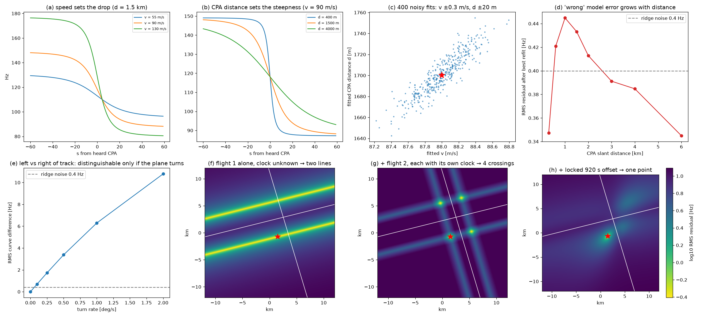

# Deep dive 2: What one Doppler curve tells you, and why two can fix a location

[← back to report](../README.md) · script: [`scripts/03_curve_information.py`](../scripts/03_curve_information.py) · output: [`plots/03_output.txt`](../plots/03_output.txt)

## 1. Speed sets the drop, distance sets the steepness (panels a, b)

For a straight pass at constant speed the received curve has a closed form. Let the source sit at s = v(t_e − t₀) along the track, with perpendicular 3-D miss distance d, and write T = t_r − t₀. The emission-time condition $c(T-s) = \sqrt{v^2 s^2 + d^2}$ is then a quadratic in s:

$$ s = \frac{c^2 T - \sqrt{c^2 v^2 T^2 + (c^2 - v^2) d^2}}{c^2 - v^2},\qquad v_r = \frac{v^2 s}{\sqrt{v^2 s^2 + d^2}},\qquad f = f_0 \frac{c}{c+v_r}. $$

* The curve's plateaus are f₀c/(c−v) and f₀c/(c+v). Their gap gives the speed: $v = c\,(f_\text{hi}-f_\text{lo})/(f_\text{hi}+f_\text{lo})$.
* The transition takes about d/v seconds. Given v, its width gives the CPA slant distance d.

The video says the same thing at 9:00: velocity sets the size of the drop and CPA distance sets how fast it happens. ✔

The fit has four unknowns: (f₀, v, d, t_c), where t_c is the *heard* CPA time on the recording clock.

## 2. How precisely? (panel c)

The test: 400 Monte-Carlo fits of a 2-minute traced ridge, 1 sample/s, 0.4 Hz Gaussian noise. True values f₀ = 110 Hz, v = 88 m/s, d = 1700 m.

| parameter | 1σ scatter |
|---|---|
| f₀ | ±0.07 Hz |
| v | **±0.3 m/s** |
| d | **±20 m** |
| t_c | ±0.07 s |
| corr(v, d) | +0.91 |

This is the idealised straight-line case. Real tracks turn and change speed, so a straight-line fit gets biased. That is why the video uses "generous" ranges, and why the end-to-end simulation uses ±20–25 % on v and −40/+60 % on d. The information is there, though. Ferguson (1992) estimated the altitude and speed of propeller aircraft from the Doppler shift of the blade-rate line at a single ground microphone, and checked the estimates against on-board records. Ferguson & Quinn (1994) and Ferguson & Lo (2000) extended the method. **Recovering speed and range from a propeller Doppler curve is established acoustics. It is not something the video made up.**

## 3. The emission-delay correction, single curve (panel d)

For one isolated curve, the "wrong" model can absorb most of the error through a free time shift and f₀. The residual is 0.35–0.45 Hz RMS for d between 0.3 and 6 km, about the tracing noise. [Deep dive 3](03-end-to-end-simulation.md) shows the correction counts most when two events are scored with one shared clock.

## 4. Left or right of the track? (panel e)

For a straight, constant-speed track the curve depends only on the 3-D perpendicular distance. Mirror-image observers on either side therefore hear **identical** curves. A turn breaks the symmetry:

| turn rate during the pass | RMS difference between mirror observers |
|---|---|
| 0°/s | 0.00 Hz (indistinguishable) |
| 0.1°/s | 0.70 Hz |
| 0.25°/s | 1.73 Hz |
| 0.5°/s | 3.38 Hz |
| 1°/s | 6.29 Hz |

The video's claim at 13:30–14:30 is that heading, speed and altitude changes "are encoded in this Doppler curve", and that matching against the *actual* ADS-B geometry uses them. That is correct. Even gentle manoeuvres produce differences well above the tracing noise. A perfectly straight, level flight leaves a two-fold ambiguity that only another event can resolve.

## 5. Geometry: lines and points (panels f–h)

Consider what is known when the clock is unknown.

* **One curve, unknown clock** (panel f). Fitting gives d. Altitude is known from ADS-B and the ground height from a DEM, so d fixes the horizontal offset from the track. The observer lies on one of **two lines** parallel to the track. The along-track position is free because the clock is free.
* **Two curves, each with its own free clock** (panel g). Two pairs of lines cross at **four points**.
* **Two curves sharing one clock** (panel h). The measured offset between the heard CPAs (920 s in the video) must equal the geometric prediction. That condition keeps one of the four crossings. In this noise-free test the best grid point is the true location (0 m error on a 100 m grid).

Counting unknowns gives the same picture. The observer has 5 unknowns: (x, y, recording clock offset T₀, f₀,₁, f₀,₂). Two curves supply about 8 fitted numbers plus fine shape detail. The system is **over-determined**, so a wrong flight pair only fits if it happens to match the speeds, distances, offset and shape within tolerance. The search over a whole country is therefore a hypothesis test over a finite set of flight pairs, and the false-match rate shrinks multiplicatively with every constraint. [Deep dive 5](05-algorithms-and-compute.md) puts numbers on this.

## Sources

**Prior acoustic flight-parameter estimation**
- B. G. Ferguson, "A ground-based narrow-band passive acoustic technique for estimating the altitude and speed of a propeller-driven aircraft", JASA 92(3):1403–1407 (1992). https://doi.org/10.1121/1.403934
- B. G. Ferguson & B. G. Quinn, "Application of the short-time Fourier transform and the Wigner–Ville distribution to the acoustic localization of aircraft", JASA 96(2):821–827 (1994). https://doi.org/10.1121/1.410320
- B. G. Ferguson & K. W. Lo, "Turboprop and rotary-wing aircraft flight parameter estimation using both narrow-band and broadband passive acoustic signal-processing methods", JASA 108(4):1763–1771 (2000). https://doi.org/10.1121/1.1286150
- Ferguson, Trider & Hanlon, "Observation of an aircraft transit using a land-based acoustic array", ASA 124th meeting abstract (1992). https://auditory.org/asamtgs/asa92nwo/1pEA/1pEA10.html

**Propeller tones**
- D. A. McCurdy & C. A. Powell, NASA TP-2356, "Annoyance caused by propeller airplane flyover noise" (1984). Tonal fundamental at the blade-passage frequency, about 50–150 Hz. https://ntrs.nasa.gov/citations/19840024054
- H. H. Hubbard (ed.), NASA RP-1258 Vol. 1, *Aeroacoustics of Flight Vehicles* (1991), ch. 1 on propeller noise. https://ntrs.nasa.gov/citations/19920001380

**Video**
- colsto, YouTube (2026). https://www.youtube.com/watch?v=UytYrhYLOKI
