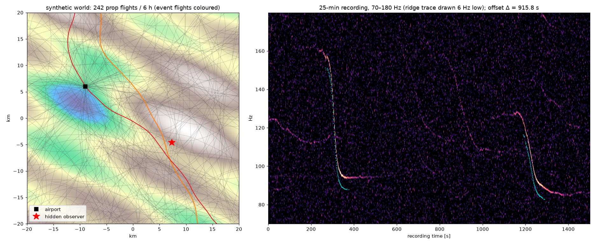
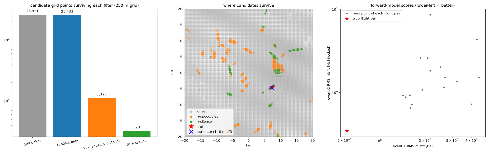
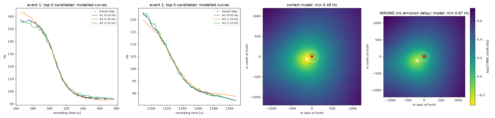
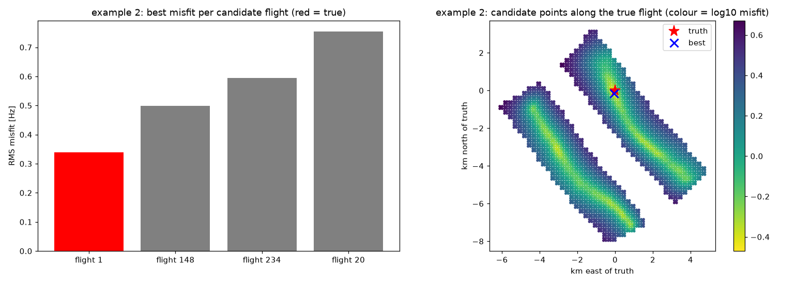
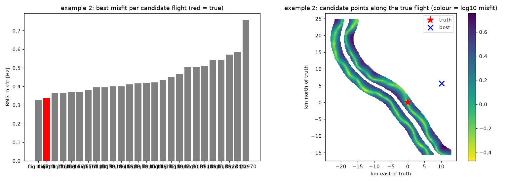

# Deep dive 3: End-to-end synthetic test of the pipeline

[← back to report](../README.md) · script: [`scripts/04_geolocate_sim.py`](../scripts/04_geolocate_sim.py) · logs: [`plots/04_output_realistic.txt`](../plots/04_output_realistic.txt), [`plots/04_output_ideal.txt`](../plots/04_output_ideal.txt), [`plots/seeds/multi_seed_realistic.txt`](../plots/seeds/multi_seed_realistic.txt)

The question here: if you build the video's pipeline exactly as described, does it find a hidden observer among many confusable flights, using only an audio file and ADS-B tracks? The simulation is deliberately set up so the analyst **does not** have the truth.

## Setup

| | truth (hidden) | what the analyst gets / assumes |
|---|---|---|
| region | 40 × 40 km hilly terrain (DEM known to both), one airport | same DEM |
| traffic | 242 propeller flights over 6 h: 65 % transits, 35 % airport arrivals/departures. Turn rate, speed and climb are random (Ornstein–Uhlenbeck processes). | — |
| ADS-B | true path at 0.5 s steps | 2 s reports, correlated 8 m position error, **+45 m barometric altitude bias**, altitude in 25 ft steps |
| atmosphere | **8 °C (c = 336 m/s), 6.7 m/s wind** | c = 343 m/s, still air |
| recording | 25 min, two flyovers 921 s apart: 118 Hz at about 1.7 km slant range, 102 Hz at about 2.4 km. Broadband SNR at CPA −4 dB and −8 dB. The audio is built purely from the emission-time physics, with 3 harmonics and white noise. | the WAV only: no clock, no location |

The analyst runs the video's steps:

1. **Spectrogram → ridge → events.** Each event gets a straight-line fit for v, d and heard-CPA time t_c.
2. **CPA tables.** For every 250 m grid point and every flight: heard-CPA time, slant distance and speed.
3. **Filters.**
   - (1) heard-CPA offset = measured Δ ± 8 s
   - (2) + speed within −20/+25 % and CPA distance within −40/+60 % of each event's fit
   - (3) + silence: no other flight within 3 km slant range during the recording
4. **Forward model.** Emission-time Doppler curves from the ADS-B splines, scored at 4 sub-points (125 m spacing) plus the centre. Event 1 gets a ±12 s alignment sweep and an f₀ refit. **Event 2 is locked** to event 1's clock and gets only its own f₀ refit.
5. Pick the best flight pair, then refine its location continuously (Nelder–Mead).



The right panel shows the two events in the recording. The ridge trace (cyan) is drawn 6 Hz low. Fainter streaks are distant flights more than 7 km away. They fall below the detection threshold, as they would for a careful human analyst.

## Result (seed 7, realistic mismatches on)



| stage | grid points left (of 25,921) | (point, flight-pair) hypotheses |
|---|---|---|
| 1: offset only | 25,433 (98 %) | 181,598 |
| 2: + speed & distance | 1,121 | 1,172 |
| 3: + silence | 323 | 323 (18 flight pairs) |
| 4: forward model | **winner: the true pair**, runner-up scores 2.4× worse | |

As the video found, the offset filter alone removes almost nothing (35k of a ~96k test area survived in the video). Speed and distance do most of the work, and silence then helps a lot. In the right panel, the true pair sits alone in the lower-left corner, matching the video's description at 21:00–22:00 of one pair that "scores a lot higher".



| | realistic (wind, cold, baro bias, ADS-B noise) | ideal (no mismatch) |
|---|---|---|
| location error after refinement | **146 m** | **4 m** |
| best-pair RMS misfit | 0.49 Hz | 0.24 Hz |
| runner-up / winner misfit | 2.40 | 3.26 |
| misfit 141 m from truth (median) | 0.81 Hz (best 0.49) | 0.53 Hz (best 0.24) |
| **wrong model** (no emission delay): best misfit / its offset from truth | 0.67 Hz / 242 m | 0.44 Hz / 85 m |

* **The 141 m remark.** Moving 141 m off the best point raises the misfit by 1.7–2.2×. That confirms the video's point that the 200 m grid is "a little bit too coarse" for the final scoring, so a 100 m grid is needed.
* **The wrong model** still lands near the truth, but with a clearly worse fit. In the video's words it doesn't "fail entirely". It does lose part of the margin that separates the winner from the confusers, so the correction matters.
* **Model mismatch** (wind, temperature, baro altitude) costs about 150 m of accuracy and about half the score margin. It does not change which pair wins.

## Robustness: 7 random worlds (realistic mismatches on)

Example 2 (one faint flight) is run twice. The first run assumes a clock known to **±1 min**, matching the narration's "8:37 p.m. UTC". The second assumes a **1-hour window** (±30 min), which is what the video's comparison slide lists for Example 2.

| seed | two events: true pair #1? | location error | runner-up / winner | example 2, clock ±1 min | example 2, 1-hour window |
|---|---|---|---|---|---|
| 7 | ✔ | 146 m | 2.40 | ✔ 158 m | ✘ true flight ranked **#2** (0.34 vs 0.33 Hz) |
| 1 | ✔ | 465 m | 1.49 | ✔ 213 m | ✘ #2 (tie at 0.38 Hz) |
| 2 | ✔ | 181 m | 1.13 | right flight, but **7.1 km** off along the track | ✘ #2 |
| 3 | ✔ | 85 m | 2.09 | ✔ 198 m | ✘ #2 (tie at 0.35 Hz) |
| 4 | — | — | — | — | — |
| 5 | ✔ | 830 m | 1.44 | ✘ wrong flight #1; true flight #2, 1.7 km off | ✘ #3 |
| 6 | ✔ | 281 m | **1.08** | ✔ 163 m (runner-up 0.37 vs 0.35 Hz) | ✘ not in top 4 |

Seed 4 is blank because automatic event detection found 3 events: a distant flight crossed the threshold, so the pipeline stopped.

**Takeaways**

* **Two events, unknown time.** The right flight pair won in all 6 worlds where the pipeline ran. The location was within 500 m in 5 of 6 and within 830 m in all. Margins vary from comfortable (2–2.4×) to a near tie (1.08×). In seed 5 the second aircraft turned during the pass. Its straight-line speed fit came out at 54 m/s against 64 m/s true, and the location is 830 m off. A robust implementation should keep the top few pairs and use the full curve shape, as the video does with its scatter plot, not trust a single score.
* **One event with the clock known to ±1 min** works in 4/6 worlds. In one more world the right flight wins but the position slides 7 km along the track, and one picks the wrong flight. With one event the along-track position is pinned only by turns and speed changes. Panel 2 of the figures below shows the long valley of low misfit on both sides of the track.
* **One event with a 1-hour window** (as on the video's slide) **failed in all 6 worlds.** The true flight ranked 2nd to 4th or lower, usually within 0.01–0.03 Hz of the winner. Widening the window from ±1 min to ±30 min multiplies the candidate (point, flight) hypotheses by about 30, from about 1.6 k to about 50 k. Among that many, some other flight's segment fits a 90 s, 0.4 Hz-noise curve equally well. Our synthetic density is about 40 propeller flights per hour in 1,600 km². A CONUS-wide search would add far more confusers. **We could not reproduce the video's Example 2 as stated on its slide.** It may still have worked for the author: the brightness scoring differs, the real track may have turned more, and the narration suggests the time was actually known to the minute. As standalone evidence it is the weakest claim in the video.
* **Not modelled:** missing ADS-B aircraft, irregular trace gaps, ground-reflection notches, refraction shadow zones, and real (non-white) background noise. All of them make things worse ([deep dive 4](04-real-world-limits.md)).
* **Bug found and fixed during finalisation.** The first version swept the event-1 alignment over only ±5 s. The heard-CPA time from the straight-line fit can sit 5–7 s from the geometric heard CPA, because turns and wind skew the curve. The sweep is now ±12 s. This changed one two-event result (seed 5: 1194 → 830 m), and it is what made the ±1 min example 2 work with an anchored search.

Example 2 at seed 7. On the left, clock ±1 min: the true flight wins clearly. On the right, 1-hour window: flight 67, 11.6 km away, edges it out.




## Reproduce

```bash
uv run scripts/04_geolocate_sim.py                      # realistic, seed 7, 1-hour example-2 window (~5 min)
```

```bash
uv run scripts/04_geolocate_sim.py --ideal --ex2-window 60   # no model mismatch, clock ±1 min (~1 min)
```

```bash
uv run scripts/04_geolocate_sim.py --seed 3 --ex2-window 60  # another random world
```

## Sources

This page is our own simulation. The physics is derived and checked in [deep dive 1](01-doppler-physics.md). The pipeline steps follow the video's narration, 04:30–21:30. For the real-world parameter choices (ADS-B 2 Hz broadcast, baro vs geometric altitude, sound speed vs temperature), see the sources in [deep dive 4](04-real-world-limits.md) and [deep dive 1](01-doppler-physics.md).
