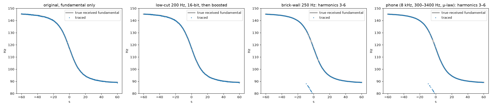

# Deep dive 4: Real-world data, error sources and countermeasures

[← back to report](../README.md) · script: [`scripts/06_phone_and_highpass.py`](../scripts/06_phone_and_highpass.py) · output: [`plots/06_output.txt`](../plots/06_output.txt)

This page asks whether the inputs the method needs actually exist and are good enough, and whether the video's claims about defences hold up.

## 1. Flight data (ADS-B)

| what the method needs | what exists | consequence |
|---|---|---|
| Position and time of nearly every propeller aircraft | ADS-B Out has been mandatory in Class A/B/C airspace, the 30 NM Mode-C veil around big airports, and Class E at or above 10,000 ft MSL since 2020 [14 CFR 91.225]. | Low-level GA in Class G/E away from big airports is **not required** to broadcast. Many aircraft do anyway, but a missing aircraft is possible. That gives a **false negative**: the true pair can't be found. It can also cause a **false positive in the silence filter**, because an unbroadcast aircraft that *was* heard is never in the data. The opposite failure is worse: an unbroadcast aircraft that was *not* heard doesn't matter. |
| Report rate | Airborne position and velocity are broadcast at about 2 Hz [Sun, *1090 MHz Riddle*]. Public archives store traces thinned to roughly 5–30 s (see [deep dive 5](05-algorithms-and-compute.md)). | Interpolation error during turns. Deep dive 5 estimates up to about 300 m for a 30 s gap in a turn. Scoring the fine shape of a curve needs dense traces. |
| Altitude | Both barometric (pressure) altitude and GNSS geometric height are broadcast [14 CFR 91.227; Sun]. OpenSky stores both as `baroaltitude` and `geoaltitude` [OpenSky Trino docs]. | Baro altitude is off from true height by an amount that depends on the weather, often tens to over 100 m. Use the geometric height when it's available. Our simulation added an unknown +45 m bias. |
| Aircraft type, to drop jets | Each aircraft's ICAO type designator maps to an ICAO Doc 8643 description such as `L1P`, whose 3rd character gives the engine type (P/T/J) [ICAO Doc 8643; SKYbrary]. ADS-B itself carries only a coarse emitter category [14 CFR 91.227]. | Works as the video describes. Unknown types are kept, which is conservative. |
| Historical archive | adsb.lol daily dumps (ODbL), ADS-B Exchange (paid historical), OpenSky (free for research) [adsb.lol; ADSBx; OpenSky]. Python access via `pyopensky` / `traffic`. | The data is easy to get. That makes the method *practical*, not merely possible. |

## 2. Terrain (DEM)

The ADS-B altitude is above sea level, so each candidate point's slant distance needs its ground elevation. USGS 3DEP covers CONUS at 1/3″ (~10 m) with about 0.8 m RMSE vertical accuracy [USGS 3DEP FAQ]. Copernicus GLO-30 is free on AWS, with <4 m absolute error (LE90), but it's a surface model that includes buildings and trees [Copernicus DEM; AWS registry]. Either is far more accurate than the method needs: d is only fitted to about ±20 m.

## 3. Sound propagation

* **Low frequencies travel far.** Atmospheric absorption at 63–125 Hz is only about 0.1–0.4 dB/km, against about 117 dB/km at 8 kHz [ISO 9613-1 / table in WindPRO appendix; Bass et al. 1995]. Spherical spreading (−6 dB per doubling of distance) dominates. That's why a ~100 Hz propeller line can be heard several km away. Propeller tones sit at the blade-passage frequency, about 50–150 Hz for existing aircraft [NASA TP-2356].
* **Temperature and wind are not modelled** in the video. The effect on the curve is about 0.5 Hz RMS for 8 m/s wind and 5 °C ([deep dive 1](01-doppler-physics.md)). The end-to-end test with 6.7 m/s wind, 8 °C and a 45 m altitude bias still located the observer to within about 150 m ([deep dive 3](03-end-to-end-simulation.md)).
* **Refraction and shadow zones.** Wind and temperature gradients bend rays [Embleton 1996]. Upwind of the aircraft, or under a temperature lapse, a nearby aircraft can be **inaudible**. That's another reason a hard silence filter can wrongly exclude the true point. Deep dive 5 recommends penalising rather than eliminating.

## 4. Countermeasures claimed in the video (26:00–28:00)

We synthesised a 110 Hz propeller pass with 6 harmonics, buried at about −14 dB broadband SNR, and applied each "defence". In every case the ridge is first normalised per frequency bin, which is what "boosting all the frequencies" does.

| treatment | weak harmonics (−4…−16 dB) | strong harmonics (−1…−4 dB) |
|---|---|---|
| original, fundamental | 100 % of frames within 1 Hz | 100 % |
| editor "low-cut", 24 dB/oct @200 Hz (−19 dB at 110 Hz), 16-bit export | **100 %**, unchanged | **100 %** |
| brick-wall high-pass @250 Hz (−60 dB), fundamental | 50 % | 49 % |
| brick-wall, harmonic sum 3–6 | 49 % | **94.5 %** |
| narrow-band phone (8 kHz, 300–3400 Hz, μ-law), fundamental | 3 % (gone) | 2 % |
| narrow-band phone, harmonic sum 3–6 | 51 % (median error 0.12 Hz) | **96.5 %** (median error 0.03 Hz) |

**What this means:**

1. **"A high-pass filter doesn't remove it": confirmed, and the reason is simple.** A linear filter scales the tone and the background noise *at the same frequency* by the same factor. The narrow-band SNR survives unless the attenuation pushes the tone below the quantisation or codec noise floor. Re-normalising per frequency ("boost") brings the curve back. Only a very steep filter that drives the fundamental toward the 16-bit floor degrades it.
2. **"It survives a phone call": plausible, but not via the fundamental.** Narrow-band telephony passes 300–3400 Hz [ITU-T P.310] (AMR-NB 200–3400 Hz [AMR]), so the ~100 Hz fundamental is removed. Every harmonic shifts by the same Doppler factor c/(c+v_r), though, so harmonic n ÷ n traces the identical curve. Whether it survives depends on harmonic strength, which in our test means 51 % vs 96.5 % of frames. The video's spectrograms show visible harmonics. Wideband codecs pass 50–7000 Hz [ITU-T G.722; AMR-WB] and keep the fundamental too. We did not model a real AMR codec's noise suppression or its own processing.
3. **"Making cuts" works against the two-event method** because it destroys the 920 s offset. Single-event localisation then needs a well-known clock, and as [deep dive 3](03-end-to-end-simulation.md) shows, it has a smaller margin.

## 5. Related precedent: forensic timestamping from mains hum

The same principle has been used forensically for years: match a faint, globally logged signal in a recording against a reference database. Electrical Network Frequency (ENF) analysis matches the 50/60 Hz mains-hum fluctuations in a recording against grid logs to timestamp and authenticate it [Grigoras 2007]. Location-specific ENF signatures have also been studied for estimating where a recording was made [Hajj-Ahmad et al. 2012; Ngharamike et al. 2023]. Aircraft-Doppler matching is the spatial analogue, with ADS-B as the reference database.

## Sources

**ADS-B regulation & format**
- 14 CFR 91.225, ADS-B Out equipment and use (Cornell LII). https://www.law.cornell.edu/cfr/text/14/91.225
- 14 CFR 91.227, ADS-B Out performance requirements (Cornell LII). https://www.law.cornell.edu/cfr/text/14/91.227
- J. Sun, *The 1090 Megahertz Riddle*, 2nd ed., TU Delft. https://mode-s.org/1090mhz/content/ads-b/1-basics.html and https://mode-s.org/1090mhz/content/ads-b/3-airborne-position.html

**ADS-B data**
- OpenSky Network, Trino historical database docs. https://openskynetwork.github.io/opensky-api/trino.html
- Schäfer et al., "Bringing Up OpenSky", IPSN 2014. https://www.cs.ox.ac.uk/publications/publication8453-abstract.html
- pyopensky. https://github.com/open-aviation/pyopensky · traffic (X. Olive). https://traffic-viz.github.io/
- adsb.lol globe_history. https://github.com/adsblol/globe_history
- ADS-B Exchange data products. https://www.adsbexchange.com/data-products/
- ICAO Doc 8643 Aircraft Type Designators. https://www.icao.int/publications/doc-8643-aircraft-type-designators · SKYbrary explainer. https://skybrary.aero/articles/aircraft-description-icao-doc-8643

**Terrain**
- USGS, "What is the vertical accuracy of the 3DEP DEMs?" https://www.usgs.gov/faqs/what-vertical-accuracy-3d-elevation-program-3dep-dems
- Copernicus DEM (Copernicus Data Space Ecosystem). https://dataspace.copernicus.eu/node/1306 · AWS Open Data Registry. https://registry.opendata.aws/copernicus-dem/

**Propagation & propeller noise**
- ISO 9613-1:1993. https://www.iso.org/standard/17426.html (scope confirmed via https://online.standard.no/en/iso-9613-1-1993)
- Bass et al., "Atmospheric absorption of sound: Further developments", JASA 97:680–683 (1995). https://doi.org/10.1121/1.412989
- EMD WindPRO Appendix A (reproduces the ISO 9613-2 absorption table). https://help.emd.dk/knowledgebase/content/windPRO4.1/Appendix_A_DECIBEL.pdf
- T. F. W. Embleton, "Tutorial on sound propagation outdoors", JASA 100:31–48 (1996). https://doi.org/10.1121/1.415879
- NASA TP-2356 (McCurdy & Powell, 1984). https://ntrs.nasa.gov/citations/19840024054

**Telephony**
- ITU-T P.310 (telephone band 300–3400 Hz). https://www.itu.int/dms_pubrec/itu-t/rec/p/T-REC-P.310-200005-S%21%21SUM-HTM-E.htm
- ITU-T G.722 (50–7000 Hz). https://www.itu.int/dms_pubrec/itu-t/rec/g/T-REC-G.722-201209-I!!SUM-HTM-E.htm
- Wikipedia, AMR (narrow-band). https://en.wikipedia.org/wiki/Adaptive_Multi-Rate_audio_codec · AMR-WB. https://en.wikipedia.org/wiki/Adaptive_Multi-Rate_Wideband

**ENF forensics**
- C. Grigoras, Forensic Sci. Int. 167:136–145 (2007). https://doi.org/10.1016/j.forsciint.2006.06.033
- Hajj-Ahmad, Garg & Wu, APSIPA 2012. https://www.mast.umd.edu/files/paper_ENF/conf_paper4_APSIPA12.pdf
- Ngharamike et al., IEEE Access (2023). https://doi.org/10.1109/ACCESS.2023.3312181
